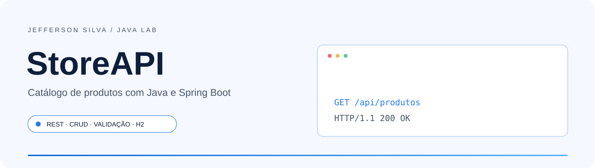
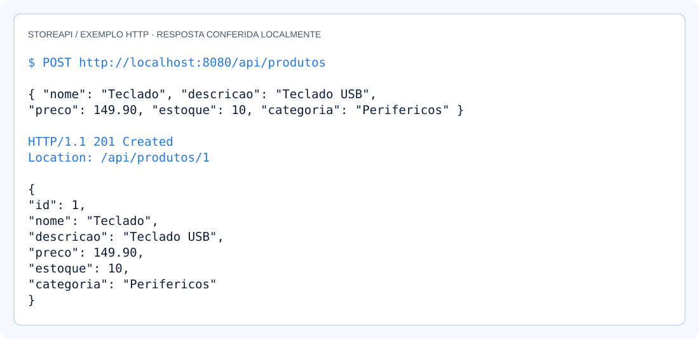
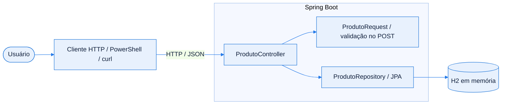
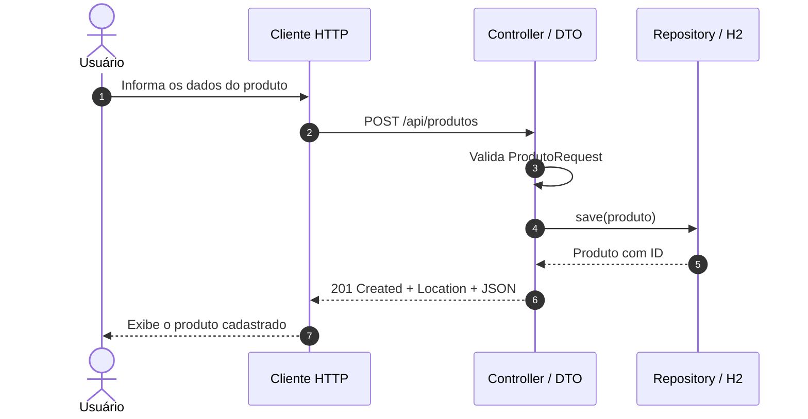
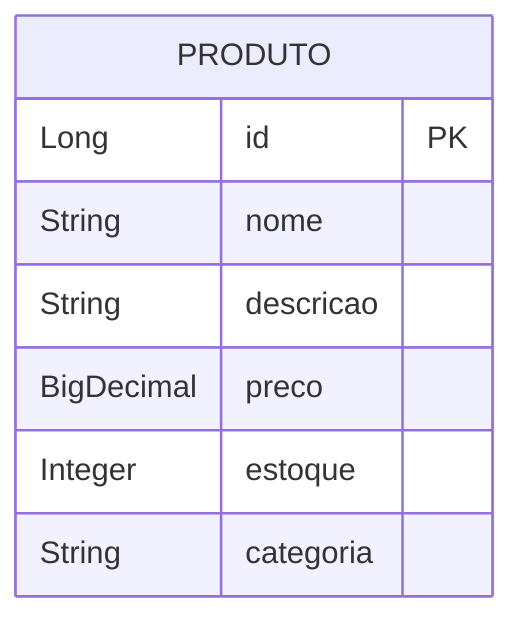

<!-- Jefferson Silva / README 4.0 — adaptado ao código da StoreAPI. -->

<div align="center">

<picture>
  <source media="(prefers-color-scheme: dark)" srcset="./assets/banner-dark.svg" />
  <source media="(prefers-color-scheme: light)" srcset="./assets/banner-light.svg" />
  
</picture>

<br />
<br />

**Uma API REST para cadastrar, consultar e gerenciar produtos em um laboratório de desenvolvimento Java.**

<p>
  <a href="#inicio-rapido"></a>
  <a href="https://github.com/jeffsilva03/storeAPI---API-Java/issues/new"></a>
</p>

[](https://github.com/jeffsilva03/storeAPI---API-Java/commits/)
[](https://github.com/jeffsilva03/storeAPI---API-Java)
[](https://github.com/jeffsilva03/storeAPI---API-Java)
[](https://github.com/jeffsilva03/storeAPI---API-Java/issues)
[](https://github.com/jeffsilva03/storeAPI---API-Java/stargazers)

<a href="#stack">
  <picture>
    <source media="(prefers-color-scheme: dark)" srcset="https://skillicons.dev/icons?i=java,spring,maven&theme=dark" />
    
  </picture>
</a>

<br />
<br />

<a href="#visao-geral">Visão geral</a> &nbsp;•&nbsp;
<a href="#demonstracao">Demonstração</a> &nbsp;•&nbsp;
<a href="#funcionalidades">Funcionalidades</a> &nbsp;•&nbsp;
<a href="#stack">Stack</a> &nbsp;•&nbsp;
<a href="#arquitetura">Arquitetura</a> &nbsp;•&nbsp;
<a href="#inicio-rapido">Instalação</a> &nbsp;•&nbsp;
<a href="#exemplos">Exemplos</a> &nbsp;•&nbsp;
<a href="#roadmap">Roadmap</a> &nbsp;•&nbsp;
<a href="#contribuir">Contribuir</a>

</div>

<br />

> [!NOTE]
> **Status:** Projeto de laboratório. O CRUD e a busca por nome estão implementados; os dados são temporários e a API não possui autenticação.

<a id="visao-geral"></a>
## ✦ Visão geral

**StoreAPI** é uma API REST de catálogo de produtos construída com Java 21 e Spring Boot 3.3.13. Permite cadastrar, listar, buscar, atualizar e excluir produtos, com persistência em H2 em memória e validação dos dados no cadastro. O projeto serve como base prática para estudar HTTP, DTOs, JPA e Bean Validation.

<table>
<tr>
<td width="33%" valign="top">

**🧩 Problema**

Praticar a construção de um catálogo de produtos e entender o caminho entre uma requisição HTTP e a persistência dos dados.

</td>
<td width="33%" valign="top">

**🛠️ Solução**

Disponibiliza endpoints REST para gerenciar nome, descrição, preço, estoque e categoria de cada produto.

</td>
<td width="33%" valign="top">

**📈 Resultado**

CRUD completo, busca por parte do nome sem diferenciar maiúsculas de minúsculas e validação no POST.

</td>
</tr>
</table>

<a id="demonstracao"></a>
## ◐ Demonstração

<div align="center">

<picture>
  <source media="(prefers-color-scheme: dark)" srcset="./assets/screenshot-dark.svg" />
  
</picture>

<sub>Fluxo HTTP — exemplo ilustrado de cadastro, com resposta conferida na execução local da API.</sub>

</div>

<details>
<summary><b>▶ Ver o fluxo em ação</b></summary>

Execute os comandos de [Exemplos de uso](#exemplos) para cadastrar, consultar, atualizar e excluir um produto. A API retorna JSON e não inclui interface gráfica própria.

</details>

<a id="funcionalidades"></a>
## ◈ Funcionalidades

<sub>✅ Implementado &nbsp; 🚧 Parcial &nbsp; 🗓️ Planejado</sub>

| Módulo | O que faz | Estado |
| :-- | :-- | :-: |
| **Catálogo** | Lista produtos e consulta por ID; retorna 404 quando o ID não existe | ✅ |
| **Cadastro** | Cria produto com DTO validado, retorna 201 e cabeçalho Location | ✅ |
| **Busca** | Filtra por parte do nome, ignorando maiúsculas e minúsculas | ✅ |
| **Atualização e exclusão** | Atualiza todos os campos via PUT e remove via DELETE | ✅ |
| **Validação na atualização** | PUT recebe a entidade diretamente, sem aplicar o DTO validado do cadastro | 🚧 |

<details>
<summary><b>▶ Regras de negócio e validações</b></summary>

| Regra | Comportamento |
| :-- | :-- |
| Nome e categoria no POST | Obrigatórios e não podem conter apenas espaços (`@NotBlank`) |
| Preço no POST | Obrigatório e maior ou igual a 0,01 (`@NotNull`, `@DecimalMin`) |
| Estoque no POST | Obrigatório e maior ou igual a zero (`@NotNull`, `@Min`) |
| Descrição | Opcional |
| ID | Gerado pelo banco de dados |
| ID inexistente | GET por ID, PUT e DELETE retornam 404 |
| Atualização | PUT substitui os campos; envie o objeto completo. Não há `@Valid` nesse endpoint |
| Persistência | Os produtos são perdidos quando a aplicação é encerrada |

</details>

<a id="stack"></a>
## ⚙ Stack e decisões técnicas

| Camada | Tecnologia | Por que foi escolhida |
| :-- | :-- | :-- |
| Linguagem | Java 21 | Versão definida no `pom.xml`; base para o laboratório de desenvolvimento Java |
| Backend | Spring Boot 3.3.13 / Spring Web | Inicialização da aplicação e exposição de endpoints HTTP com JSON |
| Persistência | Spring Data JPA / Hibernate | Repositório com operações CRUD e consulta derivada pelo nome |
| Dados | H2 em memória | Permite executar o laboratório sem instalar um servidor de banco |
| Validação | Jakarta Bean Validation | Restrições declarativas aplicadas ao DTO de cadastro |
| Código auxiliar | Lombok | Gera getters, setters e construtor sem argumentos da entidade |
| Build | Maven | Gerencia dependências, compilação e empacotamento |

> [!TIP]
> A tabela descreve o papel das tecnologias no código. O contexto educacional está registrado no [README original](./docs/README-original.md).

<a id="arquitetura"></a>
## ⬡ Arquitetura



<details>
<summary><b>▶ Responsabilidade de cada componente</b></summary>

| Componente | Responsabilidade |
| :-- | :-- |
| `StoreApiApplication` | Inicializa o Spring Boot |
| `ProdutoController` | Recebe requisições, coordena as operações e define as respostas HTTP |
| `ProdutoRequest` | Define os dados e as restrições do cadastro |
| `ProdutoRepository` | Acessa o banco via `JpaRepository` e busca por nome |
| `Produto` | Mapeia a entidade e seus campos para a persistência |
| H2 | Armazena os produtos temporariamente e oferece console local |

Não há camada de serviço separada: o controller acessa o repository diretamente.

</details>

<details>
<summary><b>▶ Fluxo principal passo a passo</b></summary>



</details>

<details>
<summary><b>▶ Modelo de dados</b></summary>



<sub>Uma entidade, sem relacionamentos. Nome, preço, estoque e categoria não aceitam null no banco.</sub>

</details>

<a id="inicio-rapido"></a>
## ⚡ Início rápido

**Pré-requisitos**

| Ferramenta | Versão | Como verificar |
| :-- | :-- | :-- |
| JDK | 21 | `java -version` e `javac -version` |
| Maven | 3.9.9 usado na verificação | `mvn -version` |
| Git | Versão recente | `git --version` |

<details open>
<summary><b>Windows · PowerShell</b></summary>

```powershell
git clone https://github.com/jeffsilva03/storeAPI---API-Java.git
cd storeAPI---API-Java
mvn clean package
mvn spring-boot:run
```

</details>

<details>
<summary><b>▶ Linux / macOS</b></summary>

```bash
git clone https://github.com/jeffsilva03/storeAPI---API-Java.git
cd storeAPI---API-Java
mvn clean package
mvn spring-boot:run
```

Os comandos Maven foram verificados no Windows com Java 21; a sequência Linux/macOS não foi executada neste ambiente. Para IDE, habilite o suporte ao Lombok e o processamento de anotações quando necessário.

</details>

> [!TIP]
> Abra **http://localhost:8080/api/produtos**. Em uma execução nova, a resposta é `[]`. O console H2 está em **http://localhost:8080/h2-console**: JDBC URL `jdbc:h2:mem:storedb`, usuário `sa` e senha vazia.

**Variáveis de ambiente**

Não é necessário criar `.env`: a configuração local está em `src/main/resources/application.properties`. O Spring Boot permite sobrescrevê-la por variáveis de ambiente.

| Variável | Obrigatória | Padrão | Descrição |
| :-- | :-: | :-- | :-- |
| `SERVER_PORT` | — | `8080` | Porta HTTP padrão do Spring Boot |
| `SPRING_DATASOURCE_URL` | — | `jdbc:h2:mem:storedb` | URL JDBC do banco H2 |
| `SPRING_DATASOURCE_USERNAME` | — | `sa` | Usuário local do banco |
| `SPRING_DATASOURCE_PASSWORD` | — | Vazia | Senha do banco local |
| `SPRING_H2_CONSOLE_ENABLED` | — | `true` | Habilita o console H2 |

> [!IMPORTANT]
> A configuração é de laboratório: banco em memória, console H2 habilitado e `ddl-auto=create-drop`. Não use esses padrões para guardar dados de produção. Credenciais reais devem ficar fora do repositório.

<details>
<summary><b>▶ Problemas comuns</b></summary>

| Sintoma | Causa provável | Como resolver |
| :-- | :-- | :-- |
| `mvn` não reconhecido | Maven fora do PATH | Instale o Maven e reabra o terminal; confira `mvn -version` |
| Erro de versão Java | JDK diferente do 21 | Ajuste `JAVA_HOME` para um JDK 21 e confira a JVM usada pelo Maven |
| Porta 8080 ocupada | Outro processo na porta | No PowerShell: `$env:SERVER_PORT=8081; mvn spring-boot:run` |
| 404 em `/` | Não há interface nem rota raiz | Acesse `/api/produtos` |
| 400 ao cadastrar | Dados inválidos | Envie nome e categoria preenchidos, preço ≥ 0,01 e estoque ≥ 0 |
| Produtos desapareceram | Aplicação foi reiniciada | O H2 é temporário; cadastre os produtos novamente |
| H2 Console não conecta | JDBC URL diferente | Use exatamente `jdbc:h2:mem:storedb` enquanto a aplicação estiver ativa |

</details>

<a id="exemplos"></a>
## ◉ Exemplos de uso

<details open>
<summary><b>▶ Cenário principal</b></summary>

```powershell
# Execute em outro terminal com a API em execução.
$base = 'http://localhost:8080/api/produtos'
$dados = @{ nome = 'Teclado'; descricao = 'Teclado USB'; preco = 149.90; estoque = 10; categoria = 'Perifericos' } | ConvertTo-Json
$produto = Invoke-RestMethod -Method Post -Uri $base -ContentType 'application/json' -Body $dados
Invoke-RestMethod -Uri "$base/$($produto.id)"
Invoke-RestMethod -Uri "$base/busca?nome=teclado"
$novosDados = @{ nome = 'Teclado'; descricao = 'Teclado USB'; preco = 129.90; estoque = 8; categoria = 'Perifericos' } | ConvertTo-Json
Invoke-RestMethod -Method Put -Uri "$base/$($produto.id)" -ContentType 'application/json' -Body $novosDados
Invoke-RestMethod -Method Delete -Uri "$base/$($produto.id)"
```

O fluxo cria um produto, consulta por ID, busca pelo nome, atualiza preço e estoque e remove o registro.

</details>

<details>
<summary><b>▶ Endpoints da API</b></summary>

| Método | Rota | Descrição | Autenticação |
| :-: | :-- | :-- | :-: |
| `GET` | `/api/produtos` | Lista os produtos (200) | — |
| `GET` | `/api/produtos/{id}` | Busca por ID (200 ou 404) | — |
| `GET` | `/api/produtos/busca?nome=teclado` | Busca parcial pelo nome (200) | — |
| `POST` | `/api/produtos` | Cadastra com validação (201 ou 400) | — |
| `PUT` | `/api/produtos/{id}` | Atualiza os campos (200 ou 404) | — |
| `DELETE` | `/api/produtos/{id}` | Exclui o produto (204 ou 404) | — |

```bash
curl -X POST http://localhost:8080/api/produtos \
  -H "Content-Type: application/json" \
  -d '{"nome":"Teclado","descricao":"Teclado USB","preco":149.90,"estoque":10,"categoria":"Perifericos"}'
```

Resposta de exemplo em um banco recém-iniciado: `201 Created`, cabeçalho `Location: /api/produtos/1` e corpo:

```json
{
  "id": 1,
  "nome": "Teclado",
  "descricao": "Teclado USB",
  "preco": 149.90,
  "estoque": 10,
  "categoria": "Perifericos"
}
```

O ID é gerado automaticamente. Uma consulta sem resultados retorna `[]`; a exclusão bem-sucedida retorna 204 sem corpo.

</details>

<details>
<summary><b>▶ Testes e qualidade</b></summary>

| Comando | O que faz |
| :-- | :-- |
| `mvn test` | Executa testes quando houver classes de teste; o repositório ainda não contém uma suíte |
| `mvn clean package` | Compila e gera `target/storeapi-0.0.1-SNAPSHOT.jar` |
| `mvn spring-boot:run` | Inicia a aplicação local |

Não há lint ou CI configurados. Build e verificações HTTP locais estão registrados em [Validação da documentação](./docs/validacao-readme.md).

</details>

<a id="roadmap"></a>
## ◇ Roadmap

- [x] Mapear a entidade Produto e o repository JPA
- [x] Implementar CRUD e busca parcial por nome
- [x] Migrar o POST para `@Valid ProdutoRequest`
- [ ] Aplicar validação equivalente no PUT
- [ ] Adicionar testes automatizados para status HTTP e regras do DTO

<sub>Os itens pendentes são sugestões de evolução, sem prazo definido. Acompanhe e sugira melhorias nas <a href="https://github.com/jeffsilva03/storeAPI---API-Java/issues">issues</a>.</sub>

<a id="documentacao"></a>
## ▤ Documentação

<details>
<summary><b>▶ Estrutura de pastas</b></summary>

```text
storeAPI---API-Java/
├── src/main/
│   ├── java/br/edu/storeapi/
│   │   ├── StoreApiApplication.java
│   │   ├── controller/ProdutoController.java
│   │   ├── dto/ProdutoRequest.java
│   │   ├── model/Produto.java
│   │   └── repository/ProdutoRepository.java
│   └── resources/application.properties
├── docs/
│   ├── README-original.md       # documentação anterior preservada
│   └── validacao-readme.md      # verificação de build e HTTP
├── assets/                     # banners e ilustrações nos dois temas
├── .gitignore
├── pom.xml
└── README.md
```

</details>

<details>
<summary><b>▶ Perguntas frequentes</b></summary>

**Preciso instalar um banco de dados?**
Não. O H2 roda dentro da aplicação e guarda os dados em memória.

**Existe frontend, Swagger ou deploy público?**
O repositório contém somente a API; não inclui frontend, configuração de Swagger ou endereço público de demonstração.

**PUT e DELETE ainda são tarefas pendentes?**
Não. O README original registrava essas tarefas do laboratório, mas os dois métodos já estão implementados. O POST também já usa DTO com `@Valid`.

**O projeto tem licença de uso?**
Não há arquivo de licença no repositório; nenhuma licença foi presumida nesta documentação.

</details>

<details>
<summary><b>▶ Limitações e segurança</b></summary>

- **Limitações:** armazenamento temporário, listagem sem paginação e ausência de testes automatizados. O PUT não aplica as restrições do DTO de cadastro.
- **Segurança:** não há autenticação nem autorização; o console H2 está habilitado para uso local. Evite expor essa configuração à internet.
- **Reportar vulnerabilidade:** não publique segredos ou detalhes exploráveis em issues públicas. O projeto ainda não informa um canal privado específico; combine um canal reservado com o autor antes de enviar esses dados.

</details>

<a id="contribuir"></a>
## ⇄ Contribuir

1. Faça um fork e crie uma branch: `git checkout -b feat/minha-melhoria`
2. Faça commits seguindo o padrão abaixo
3. Rode `mvn clean package`, confira os endpoints alterados e execute os testes disponíveis antes de abrir o PR
4. Abra um Pull Request descrevendo o que mudou e por quê

<details>
<summary><b>▶ Padrão de commits</b></summary>

| Prefixo | Quando usar | Exemplo |
| :-- | :-- | :-- |
| `feat` | Nova funcionalidade | `feat: adiciona filtro por data` |
| `fix` | Correção de bug | `fix: corrige cálculo do total` |
| `docs` | Só documentação | `docs: atualiza instalação` |
| `refactor` | Mudança interna sem alterar comportamento | `refactor: separa serviço de e-mail` |
| `test` | Testes | `test: cobre fluxo de login` |
| `chore` | Configuração e manutenção | `chore: atualiza dependências` |

</details>

## ◎ Autor

<table>
<tr>
<td align="center" width="140">
  <a href="https://github.com/jeffsilva03"></a>
</td>
<td>

**Jefferson Silva**<br />
Autor da StoreAPI<br />
Projeto de laboratório com Java, Spring Boot e APIs REST.

<a href="https://github.com/jeffsilva03"></a>

</td>
</tr>
</table>

---

<div align="center">

Se este projeto foi útil, considere deixar uma ⭐ — isso ajuda outras pessoas a encontrá-lo.

<br />

<a href="#visao-geral"></a>

<sub>Java &nbsp;•&nbsp; Spring Boot &nbsp;•&nbsp; APIs REST</sub>

</div>